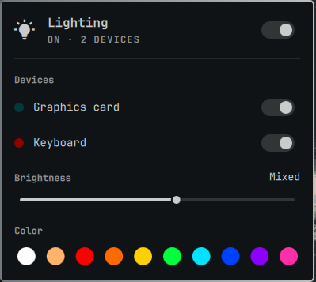

# Lighting for the Omarchy bar



A lightbulb in the bar for your PC's RGB lights: switch everything (or one
device) on or off, set brightness, and pick a color. It works through
[OpenRGB](https://openrgb.org), which knows how to talk to most graphics
cards, motherboards, RAM, keyboards, mice and LED strips.

## Install

```sh
omarchy plugin add https://github.com/cylon58/omarchy-lighting.git --enable
```

Then click the bulb. If OpenRGB isn't installed, the panel has an
**Install OpenRGB** button: it opens a terminal, asks for your password once,
installs the `openrgb` package and loads its device rules. Restart the PC once
afterwards so every device is reachable.

## Use

| On the bulb | Does |
| --- | --- |
| Click | Open the panel |
| Right-click | All lights on or off |
| Scroll | Brighter or dimmer |

In the panel, the top switch is the master switch and each device has its own
switch. The slider and colors apply to every device; click a device's name to
adjust just that one, and click it again (or All) to go back. Brightness reads
"Mixed" when devices differ; moving it with All picked sets them all. Turning everything off
keeps each device's look, so it comes back the same.

Devices OpenRGB finds with no LEDs set up (an empty motherboard header) get no
switch. To use one, set its size once in the OpenRGB app.

## What it runs and writes

- Starts OpenRGB's server when nothing is listening on its port (127.0.0.1:6742), as
  the user service `cylon58-lighting-openrgb`, which lasts until you log out.
  An OpenRGB server you already run is used as it is.
- Runs `openrgb -ld` to list devices: every 2 seconds for a minute after
  OpenRGB starts, every 3 seconds while the panel is open, and once a minute
  otherwise. When the list changes (at login, after a replug), OpenRGB
  restarts or the PC wakes from sleep, it sends your look again with
  `openrgb -d N -c RRGGBB`.
- Saves your settings to `~/.local/state/omarchy-lighting/state.json`. The
  first time, it starts from the settings of the older Lighting app
  (`~/.config/lighting/state.json`) if you had it.

## Remove

```sh
omarchy plugin remove cylon58.lighting
rm -r ~/.local/state/omarchy-lighting
```

OpenRGB stays installed; remove it with `sudo pacman -R openrgb` if nothing
else uses it.

## Develop

```sh
MODEL_PATH=Model.js node --test tests/model.test.cjs
omarchy plugin validate .
```
